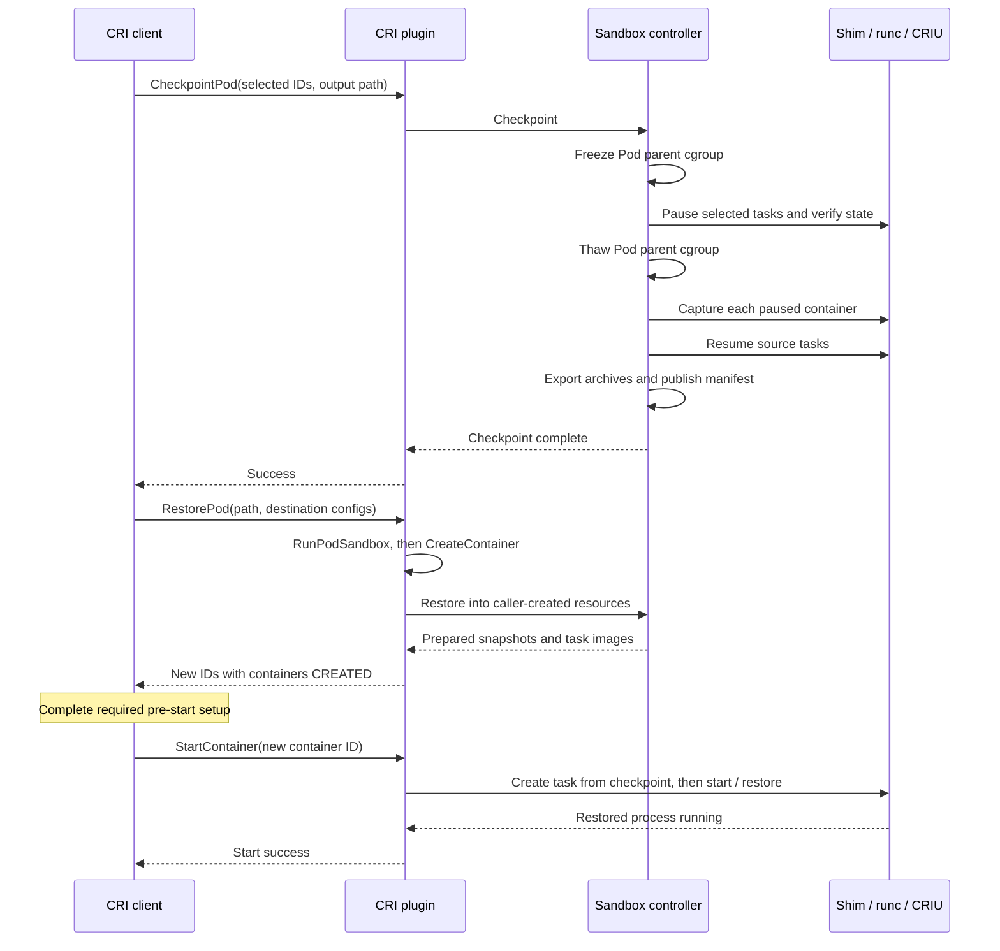

<!--
Copyright The containerd Authors.

Licensed under the Apache License, Version 2.0 (the "License").
You may not use this file except in compliance with the License.
You may obtain a copy of the License at

    http://www.apache.org/licenses/LICENSE-2.0

Unless required by applicable law or agreed to in writing, software
distributed under the License is distributed on an "AS IS" BASIS,
WITHOUT WARRANTIES OR CONDITIONS OF ANY KIND, either express or implied.
See the License for the specific language governing permissions and
limitations under the License.
-->

# Pod checkpoint and restore

This document describes the CRI APIs and sandbox-controller interfaces for
Pod checkpoint and restore in containerd. The checkpoint mechanism depends
on the selected backend. The detailed walkthrough covers the built-in Linux
`podsandbox` controller with the runc v2 shim and CRIU.

Checkpointing saves selected running containers so their processes can later
continue from the captured state. Checkpoint leaves the source containers
running after capture. Restore creates a new sandbox and new container
identities instead of replacing the original Pod in place.

Restore has two stages: `RestorePod` prepares containers in `CREATED` state,
then `StartContainer` restores and runs each captured process. Keeping these
stages separate lets the caller complete pre-start setup before execution.

## Interfaces and responsibilities

The CRI plugin owns request validation and the sandbox/container lifecycle.
It delegates checkpoint-format and runtime-specific work to the sandbox
controller's optional `CheckpointController` interface.

| Component | Responsibility |
| --- | --- |
| CRI client, such as kubelet or crictl | Select containers, supply configs |
| CRI plugin | Validate, create resources, save references, roll back |
| Sandbox checkpoint controller | Capture or prepare backend-specific state |
| Containerd client and task services | Manage checkpoint content and tasks |
| Runtime backend | Save and restore process or sandbox state |

The three relevant CRI operations are:

- `CheckpointPod`: takes a sandbox ID, an explicit nonempty list of running
  container IDs, an output directory and optional backend options. It returns
  an empty success response after publishing the checkpoint.
- `RestorePod`: takes a checkpoint directory, a destination sandbox config,
  one destination config per saved container, an optional runtime handler and
  backend options. It returns the new sandbox ID and container name/ID pairs.
- `StartContainer`: starts an individual prepared container from its saved
  state. `RestorePod` does not start the containers as a group.

Both Pod RPCs require a finite, unexpired caller deadline and an absolute
checkpoint path on the runtime host. Option keys and checkpoint formats are
backend-specific. The built-in pause-container backend currently rejects
every nonempty checkpoint or restore options map.

`CheckpointPod` does not automatically select every container in the Pod.
The caller chooses the set. The current `crictl checkpointp` command selects
all containers that CRI reports as running in the sandbox.

Runtime selection has two parts. A CRI runtime-handler name, such as `runc`,
selects a configured runtime type and sandbox controller. Checkpoint uses the
source sandbox's stored controller. Restore resolves the destination handler.
`--runtime=runc` names the handler, not the runtime type
`io.containerd.runc.v2` or the controller name `podsandbox`.

Other controllers can provide the same optional API. Forwarding that API to a
shim or remote controller does not establish that the backend implements it.
An unsupported backend returns `Unimplemented`.

Controllers can prepare restore state without a containerd task checkpoint
image. They leave `TaskCheckpointImage` empty in that case. Every backend
must still leave destination containers prepared for later `StartContainer`
calls, without starting the captured processes during `RestorePod`.

## Runtime backends

CRIU is a requirement of the built-in pause-container backend, not of the
CRI Pod APIs. Other sandbox controllers can use a different checkpoint
engine and format.

- **runc:** the built-in controller uses task checkpoint operations to invoke
  runc and CRIU. CRIU captures and restores Linux process state. The capture
  sequence, directory layout, recovery markers and example below describe
  this path.
- **gVisor:** native checkpointing saves Sentry state and application memory
  without CRIU. Its [checkpoint and restore commands][gvisor-checkpoint] use
  gVisor's own state files. However, the checked [runsc shim][gvisor-shim]
  returns `ErrNotImplemented` from the standard task checkpoint method.
  Its separate gVisor task-service extension does implement native
  checkpointing. Connecting that mechanism to these Pod APIs requires a
  backend that maps sandbox state, destination identities and deferred start
  into the CRI lifecycle. Native gVisor checkpoint support alone does not
  establish support for these Pod RPCs.
- **Kata Containers:** VM snapshot mechanisms save guest memory and
  hypervisor state. For example, Kata's [VM template factory][kata-template]
  saves an initialized VM before workload creation. That does not establish
  checkpoint support for a running Pod. The checked [Go shim][kata-shim]
  returns `ErrNotImplemented` for task checkpoint. Pod-level integration is
  being developed in [Kata's checkpoint/restore proposal][kata-pod-checkpoint].
  Support depends on the runtime and hypervisor implementation.

Selecting a gVisor or Kata runtime handler does not by itself provide that
integration. A handler that still selects `podsandbox` reaches the built-in
backend, including its CRIU check. A native backend must implement the
optional checkpoint service and the required restore lifecycle. Checkpoint
files from different engines are not interchangeable.

## Configuration and prerequisites

The CRI runtime configuration controls container and Pod checkpoint/restore:

```toml
[plugins.'io.containerd.cri.v1.runtime']
  enable_checkpoint_restore = true
```

On Linux, an unset setting enables the feature. The Pod implementation is
Linux-only. The old `enable_criu` setting remains a deprecated alias. Setting
the two options to different values prevents the CRI runtime plugin from
loading. See [CRI configuration][config] for migration details.

The following prerequisites apply to the built-in pause-container backend.
The generic CRI entry points do not perform the CRIU availability check.

- The runc v2 shim and runc checkpoint/restore support. Other controllers
  must check their own runtime requirements.
- CRIU 3.16 or newer, discoverable through the shim's effective executable
  search path. The backend caches the availability/version check.
- A running sandbox and running selected containers, with matching CRI and
  runtime task state.
- A dedicated Pod cgroup parent in the sandbox configuration. It must be a
  clean, absolute path within the cgroup hierarchy, such as `/my-pod`, rather
  than `/sys/fs/cgroup/my-pod`. The root cgroup is rejected. The backend checks
  the selected containers' and pause container's actual OCI cgroup paths.
- A usable cgroup v2 freezer, or the cgroup v1 freezer controller. The Pod
  parent must not already be frozen or transitioning when capture begins.
- An existing, empty, absolute output directory whose final component is a
  real directory, not a symlink.

The CRI caller creates and protects the checkpoint directory. For a Kubernetes
`PodCheckpoint`, kubelet creates it before calling CRI. With direct `crictl`
use, the operator creates it on the runtime host. A private directory with
mode `0700` is appropriate: the files contain process memory and saved
configuration. Containerd writes its metadata and archives with mode `0600`.
Structural validation does not authenticate a checkpoint's origin. Access to
checkpoint data must remain controlled by the trusted node operator.

## Checkpoint sequence

The source sandbox remains the same sandbox throughout checkpointing.

1. **Validate and reserve the request.** CRI resolves the sandbox and selected
   container IDs. IDs and metadata names must be unique, each container must
   belong to that sandbox, and all selected containers must be running.
   Reservations prevent overlapping checkpoint operations on those containers.

2. **Validate the backend inputs.** The controller checks CRIU, runtime tasks,
   cgroup membership and output-directory requirements. It reserves the
   sandbox transaction and canonical output directory. The current format
   permits at most 1,024 selected containers.

3. **Save recovery information.** Containerd writes `pod-config.json` and
   durably publishes a separate recovery marker before requesting a freeze.
   A previous unfinished checkpoint of the sandbox must first be recovered.

4. **Establish the capture point.** The controller freezes the entire Pod
   parent cgroup and waits for confirmation. It then pauses every selected
   runtime task and verifies that each reports `Paused`. Finally, it thaws
   the parent cgroup. The selected task cgroups remain paused. The sandbox
   and unselected descendants can run again.

5. **Capture selected containers.** While the selected tasks remain paused,
   the controller checkpoints each container sequentially. It saves runtime
   metadata, the writable-layer diff and task state in a temporary containerd
   checkpoint image. The task request reaches the runc shim and CRIU through
   `runc checkpoint`. The source task is not requested to exit, and file-lock
   handling is enabled. Base-image contents are not included.

6. **Resume the source.** Once every capture finishes, the controller resumes
   the selected tasks and verifies their state. It durably records that the
   resume phase has completed. The source can now continue changing while
   the captured images remain fixed.

7. **Export and publish.** Containerd exports one OCI archive per selected
   container, then writes `checkpoint-manifest.json` last. Archive export
   therefore happens outside the interval in which the selected tasks are
   paused. Deferred cleanup removes temporary image records and the recovery
   marker, retrying failed cleanup as described below.

The initial parent freeze stops all descendants, but only the requested
containers are captured. An unselected container's process state is not part
of the checkpoint. The pause container is recreated through the normal sandbox
lifecycle during restore.

## Checkpoint files

The pause-container backend writes this directory layout:

```text
checkpoint-directory/
  pod-config.json
  container-<sha256-of-source-container-id>.tar
  container-<sha256-of-another-source-container-id>.tar
  checkpoint-manifest.json
```

The version-2 manifest records the original sandbox ID and each selected
container's name, original ID, archive filename, CRI configuration and CRI
status. `pod-config.json` stores the source sandbox configuration.

Each `.tar` is an OCI archive containing a containerd checkpoint index and
content blobs for runtime/task data, the saved OCI specification,
checkpoint options and the writable-layer diff. It is not the legacy
`CheckpointContainer` forensic archive. The destination still needs the base
container images in its local image store.

Archives are written to temporary files, synced, renamed to their final names
and followed by a directory sync. Metadata uses an atomic file writer and
directory sync. Publishing the manifest last marks the completed checkpoint.
Callers should treat the directory as a runtime-owned format and pass it back
unchanged to `RestorePod`.

On a failed request, cleanup attempts to remove partial output while keeping
the caller's directory. File-removal failures are logged and are not always
retained for retry in a recovery marker. A failed checkpoint can therefore
leave files behind. Another checkpoint requires an empty output directory.

The writable-layer diff covers the container snapshot. It does not back up
external mounted-volume contents or external services. Restoring those
resources, or coordinating them with the captured processes, is the caller's
responsibility.

## Restore preparation

`RestorePod` creates a fresh sandbox and containers using the ordinary CRI
lifecycle. With the built-in pause-container backend and runc, preparation
then proceeds as follows:

1. **Check initial prerequisites.** CRI checks the deadline, absolute checkpoint
   path, feature setting, request configs, unique container names and runtime
   handler/controller selection. Every base container image must be locally
   available. `RestorePod` does not pull those images or apply their image-pull
   policy. Normal sandbox creation can still pull a missing pause image.

2. **Create destination resources.** CRI calls `RunPodSandbox`, then
   `CreateContainer` for every supplied container config. These allocate new
   sandbox and container IDs and prepare the destination environment and
   snapshots. The sandbox is running, but the containers remain `CREATED`.

3. **Read and validate the checkpoint.** The controller opens the checkpoint
   directory read-only and validates the manifest, saved configs and archive
   structure. It uses bounded reads and regular-file/no-follow checks, and
   validates index descriptors and content. The supplied container names
   must exactly match the complete saved set, independent of request order.

4. **Check compatibility.** The backend compares sandbox Linux security
   context, sysctls and ordered port mappings. For each container it compares
   working directory, TTY setting and Linux security context. It also compares
   the resolved base-image configuration digest and runtime type with the
   checkpoint. Different tag/reference strings may resolve to the same image.

5. **Prepare the snapshots and task images.** The controller imports each
   archive under a deterministic temporary image name and applies its
   writable-layer diff to the newly created container snapshot. Import leases
   and content-reference labels retain the required blobs. No container task
   is created and CRIU has not yet restored any process.

6. **Save the pending restore.** CRI verifies that the controller returned
   exactly the expected names and newly created IDs. It durably saves each
   prepared image reference as `TaskCheckpointImage` in that container's
   status, then returns the sandbox ID and container name/ID mapping.

Checkpoint-format and detailed compatibility validation happen after normal
resource creation. If preparation fails, the controller attempts to delete
its imported images and CRI attempts to remove the new sandbox and containers.
Cleanup failures are included in the returned error. The original checkpoint
directory is neither rewritten nor deleted by restore.

The destination Pod can have a new identity and hostname. Request command,
argument and environment values can describe the destination, including its
Downward API values, but they do not replace the captured process's argv or
environment. CRIU resumes that saved process rather than launching a fresh
entrypoint. Other restore prerequisites depend on the runtime and workload.
These checks do not establish compatibility with every host or kernel.

## Starting a restored container

The caller performs required pre-start setup, then calls `StartContainer` for
each returned container ID. On the runc v2 path, start loads
`TaskCheckpointImage` and passes it through `WithTaskCheckpoint` when creating
the containerd task.
Normal CRI start handling, including the NRI start callback, runs before the
task is started.

For the runc v2 shim, the task initially has checkpoint-specific created
state. Its `Start` operation invokes `runc restore`. This is when CRIU restores
the saved process and execution begins. File-lock restoration is enabled.
Consequently, a successful `RestorePod` response proves preparation completed,
not that the eventual process restore will succeed.

The diagram shows the built-in runc/CRIU path:



After successful start, CRI deletes the consumed task checkpoint image and
clears its stored reference. Cleanup failure is logged and retried during
daemon recovery or container removal. A daemon restart preserves the image
references of unstarted `CREATED` containers so they can still be restored.
Removing a prepared container also cleans up its image.

Restore checkpoint-image deletion waits for containerd garbage collection.
Content still referenced by another image or lease is retained.

A failed start follows normal CRI failure handling and can leave the container
`EXITED`. Callers should not assume that starting the same ID again retries
the restore. The checkpoint directory remains available for another
`RestorePod` operation with new destination resources.

## Interrupted checkpoints and recovery

Recovery markers are separate from the caller's checkpoint directory. They
live under the pause-controller plugin root in
`checkpoint/pod-checkpoint-freezes/`. A marker records the containerd
namespace, sandbox ID, Pod cgroup parent, selected IDs, canonical output path
and whether the source tasks have resumed. Marker updates and removal are
synced so recovery can distinguish runtime recovery from image cleanup.

On failure or cancellation, checkpoint cleanup attempts to thaw the parent
and resume affected tasks using a separate bounded cleanup context in the
request's namespace. Failed operations retain the marker for another attempt.
Completed thaw/resume work is retained in memory, so retries in the same
daemon do not repeat it after a marker-write failure.

At startup, the controller attempts marker recovery before CRI reloads its
stores. Recovery errors do not prevent startup: remaining markers are retried
in the background with backoff and before the next checkpoint of that sandbox.
Running, exited and missing tasks do not need resuming. Recovery does not
recreate or restart them. A marker with `tasksResumed=true` requires only
output/image cleanup. Recovery keeps published checkpoints and removes known
partial-output files when the manifest is absent.

Independent clients must not pause the selected tasks or freeze their Pod
cgroup while checkpoint recovery is pending. The task API has no pause-owner
token. After a daemon crash between resuming tasks and saving that phase, or
a runtime error after applying a resume, recovery cannot distinguish a
checkpoint pause from a pause requested by another client. In-memory progress
does not remove that ambiguity across a daemon restart.

## Example with crictl

Use a crictl build that includes `checkpointp` and `restorep`, configured for
the target runtime and image endpoints. The checkpoint path is on the runtime
host. Choose timeouts large enough for both capture and the later process
restore.

Create an empty output directory before calling `checkpointp`. Containerd
requires that directory to exist. Mode `0700` restricts access to its owner.
The example assumes the parent directory already exists:

```sh
mkdir -m 0700 /var/lib/pod-checkpoints/example
crictl --timeout=120s checkpointp \
  --path=/var/lib/pod-checkpoints/example POD-ID

# Pull each required base image before restore.
crictl pull IMAGE-REFERENCE
crictl --timeout=120s restorep \
  --pod-config=restored-pod.json \
  --container-config=app.json \
  --container-config=sidecar.json \
  --output=json \
  /var/lib/pod-checkpoints/example > restored.json

jq -r '.restoredContainers[] | [.name, .containerId] | @tsv' restored.json

# Complete pre-start setup, then use the returned container IDs.
crictl --timeout=120s start APP-CONTAINER-ID SIDECAR-CONTAINER-ID
```

Supply one container config for every saved container, with matching metadata
names and compatible destination settings. Use `--runtime` on `restorep` when
the default handler is unsuitable. JSON or YAML output includes the container
IDs. The default summary prints only the new sandbox ID.

## Scope and limits

- The existing [`CheckpointContainer` RPC][legacy] captures one container into
  a forensic archive. Its format is different from the Pod directory format,
  and it has no paired `RestoreContainer` CRI RPC.
  Kubelet creates the parent storage directory and passes an archive filename.
  Containerd creates the archive file and its internal staging directory.
  The Pod API instead receives an existing, empty output directory.
- The built-in pause-container backend uses defaults that disable open-TCP,
  external-Unix-socket and terminal checkpoint options. The Pod options maps
  cannot currently enable them. Supported process resources depend on the
  runtime and CRIU, not just the presence of the CRI methods.
- Capturing memory and writable-layer changes does not checkpoint a cluster,
  copy mounted volumes, or coordinate external storage and services.
  Destination networking and mounts are created through the normal lifecycle.
- The source snapshotter is recorded in the checkpoint index, but the backend
  does not enforce destination snapshotter equality. That does not establish
  compatibility with every snapshotter combination.
- Scheduling, checkpoint-data transport, access authorization and workload
  coordination belong to the caller. Matching runtime types and image identity
  checks alone do not guarantee cross-host or cross-kernel restore.

## Source map

- [CRI entry points][entry]: request validation, resource creation, controller
  dispatch, exact restore-result matching and rollback.
- [Controller interface][interface]: the optional capability and ownership of
  prepared task checkpoint images.
- [Pause-controller backend][backend]: checkpoint layout, capture, import,
  writable-layer application and compatibility checks.
- [Cgroup freezer][freezer] and [checkpoint recovery][rec]: freezing,
  task pause/resume, durable markers and restart recovery.
- [Container start][start], [removal][remove] and [daemon recovery][restart]:
  consuming, retaining and deleting task checkpoint images.
- [Client checkpoint][client] and [runc shim start state][shim]: runtime
  checkpoint options and the deferred process restore.
- [Sandbox API][sandbox-doc], [CRI architecture][architecture] and
  [CRI configuration][config]: related design and configuration documentation.

[entry]: ../../internal/cri/server/sandbox_checkpoint_api.go
[interface]: ../../core/sandbox/controller.go
[backend]: ../../internal/cri/server/podsandbox/sandbox_checkpoint_linux.go
[freezer]: ../../internal/cri/server/podsandbox/pod_cgroup_freeze_linux.go
[rec]: ../../internal/cri/server/podsandbox/pod_checkpoint_recovery_linux.go
[start]: ../../internal/cri/server/container_start.go
[remove]: ../../internal/cri/server/container_remove.go
[restart]: ../../internal/cri/server/restart.go
[client]: ../../client/container.go
[shim]: ../../cmd/containerd-shim-runc-v2/process/init_state.go
[sandbox-doc]: ../sandbox-api.md
[architecture]: architecture.md
[config]: config.md
[legacy]: ../../internal/cri/server/container_checkpoint_linux.go
[gvisor-checkpoint]: https://gvisor.dev/docs/user_guide/checkpoint_restore/
[gvisor-shim]: https://github.com/google/gvisor/blob/30ace3e2a91e0832ab53234c8cf17cc38ee90f72/pkg/shim/v1/runsc/service.go#L572
[kata-template]: https://github.com/kata-containers/kata-containers/blob/517aa920df7af5195baa664a6fb1f7e2de2ba54e/src/runtime-rs/crates/runtimes/virt_container/src/factory/template.rs#L199-L220
[kata-shim]: https://github.com/kata-containers/kata-containers/blob/517aa920df7af5195baa664a6fb1f7e2de2ba54e/src/runtime/pkg/containerd-shim-v2/service.go#L940-L954
[kata-pod-checkpoint]: https://github.com/kata-containers/kata-containers/pull/13654
